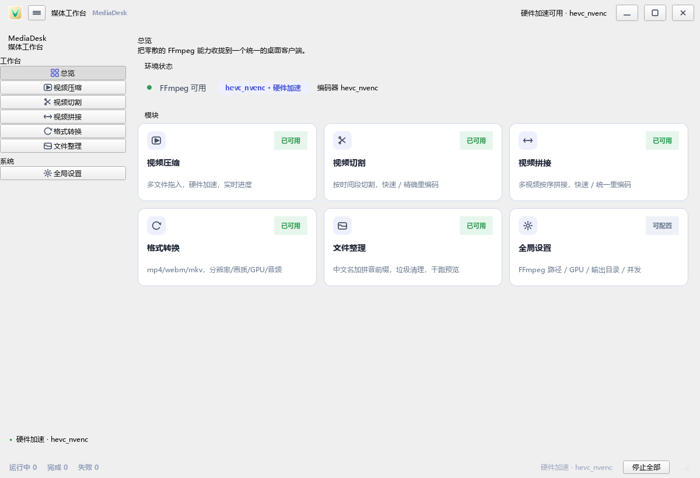
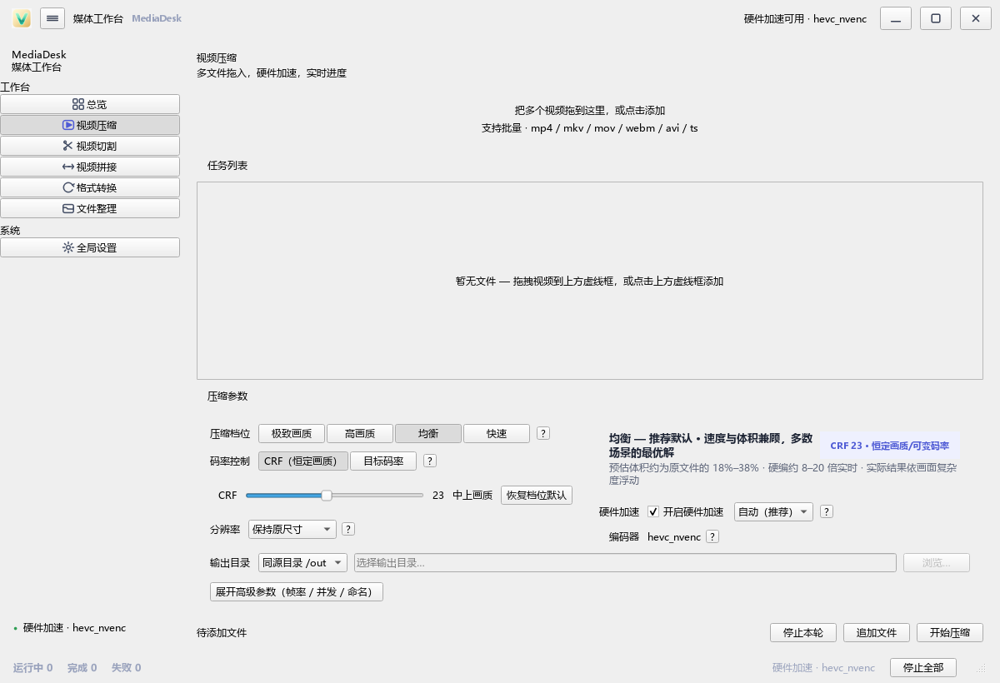
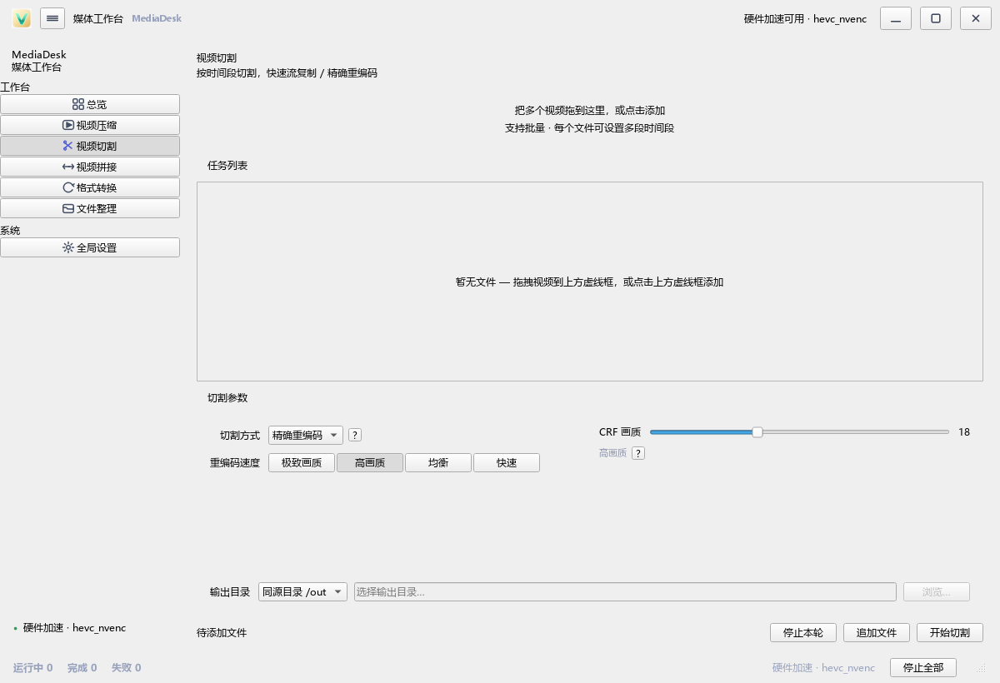
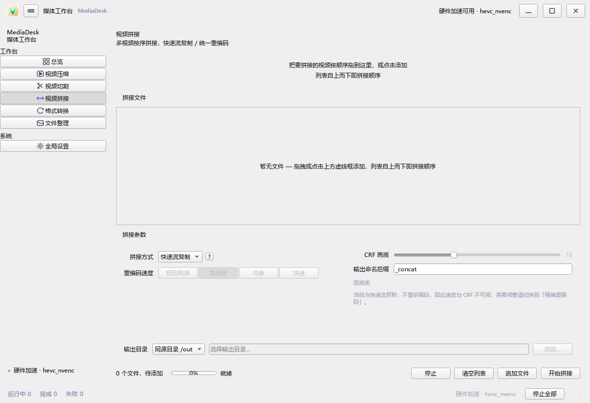
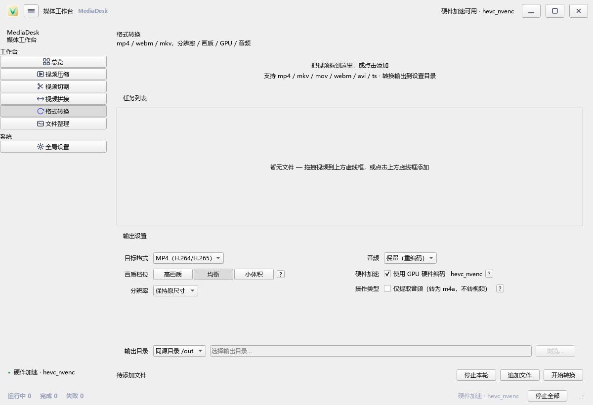
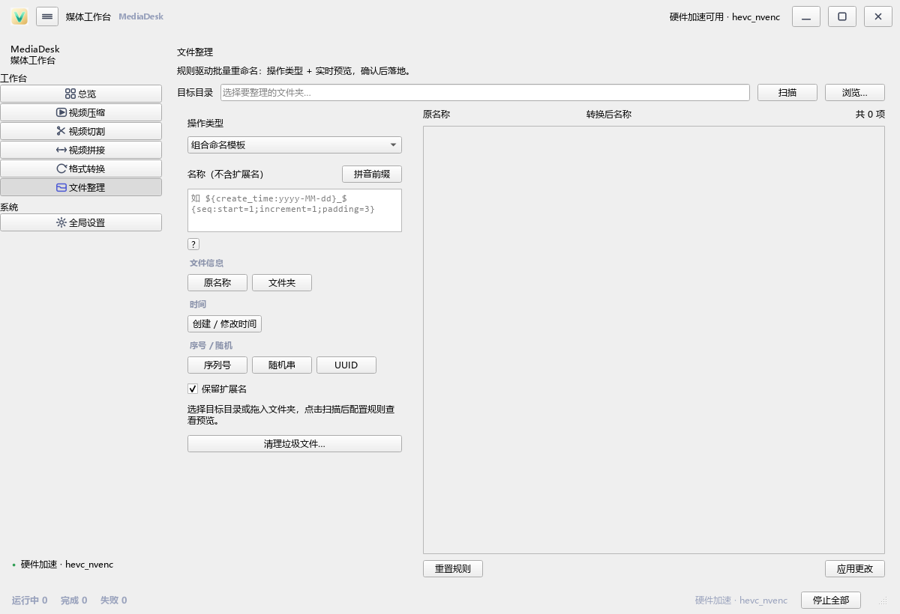
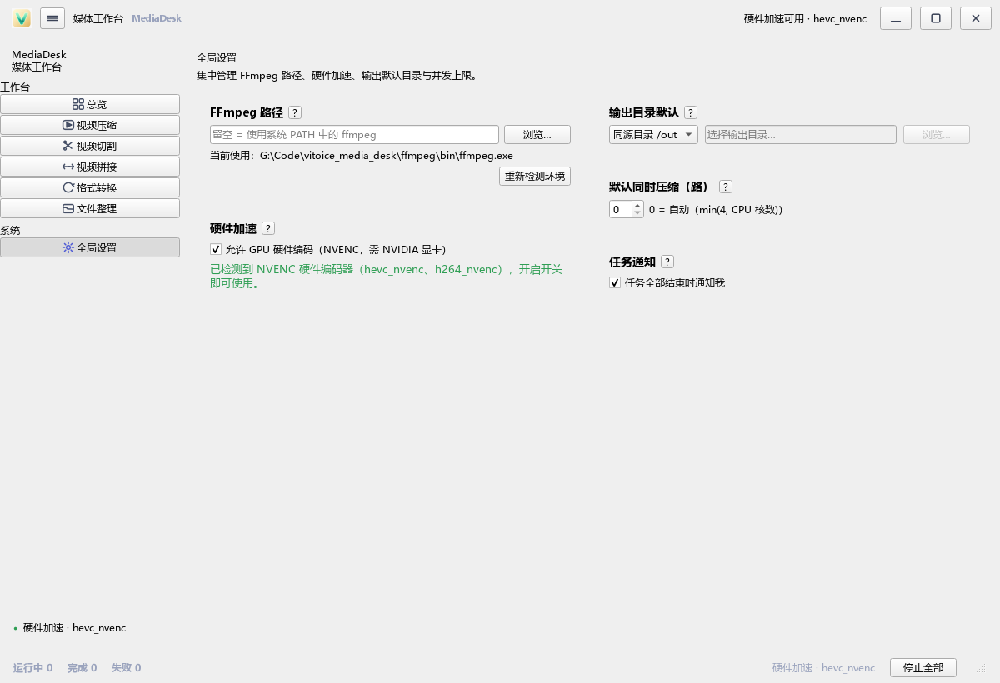

# MediaDesk 媒体工作台


把零散的 FFmpeg 能力收拢到一个统一的桌面客户端。基于 **PySide6**，提供视频压缩 / 切割 / 拼接 / 格式转换 / 文件整理 / 全局设置 六大模块，统一的浅色主题与直观的拖拽交互。

> 主要面向媒体管理与整理场景，为设计师 / 开发者提供一条龙、可视化的批量处理工作台。

## 界面一览



 

 

 

> 完整操作流程见 [docs/使用说明.md](docs/使用说明.md)。

## 功能总览

| 模块 | 说明 |
| --- | --- |
| 总览 | 环境检测（FFmpeg / GPU / 编码器）+ 模块入口 |
| 视频压缩 | 四档位预设包（极致画质 / 高画质 / 均衡 / 快速），CRF 恒定画质 ⇄ 目标码率双模式，档位切换全参数联动 |
| 视频切割 | 按时间段切割，快速流复制 / 精确重编码，四档速度 + CRF 滑杆，多段时间轴 |
| 视频拼接 | 多视频按序拼接，快速 / 统一重编码，四档速度 + CRF 滑杆，支持排序调整 |
| 格式转换 | mp4 / webm / mkv 容器互转，分辨率 / 画质档位 / GPU / 音频开关，仅提取音频 |
| 文件整理 | 组合模板重命名（拼音前缀 / 时间 / 序号 / 随机 / UUID）、垃圾文件清理、干跑预览 |
| 全局设置 | FFmpeg 路径 / GPU / 输出目录 / 并发上限 / 完成通知 |

- 所有媒体页支持**拖拽添加文件**、实时进度展示、可取消任务。
- 硬件加速（GPU 编码：`hevc_nvenc` 等）与编码器选择在压缩 / 转换 / 设置各页实时同步。
- 压缩档位说明卡会根据**当前档位、CRF、分辨率、总时长**实时重算预估体积与处理速度。
- 全局**浅色主题**，不受系统深色模式影响；下拉与分段控件统一自绘，风格一致。

## 环境要求

- **Python 3.11+**（建议 3.12）
- 操作系统：Windows 10 / 11
- 完整版 **FFmpeg**（含 `libx264` / `libx265` / `libvpx`）；启用 GPU 硬编需对应 NVENC 支持的 FFmpeg 构建

## 安装

```bash
# 1. 创建并激活虚拟环境
python -m venv .venv
.venv\Scripts\activate

# 2. 安装依赖
pip install -r requirements.txt

# 3. （可选）下载随包 FFmpeg 二进制
python scripts/fetch_ffmpeg.py
```

FFmpeg 查找优先级：**手动配置路径 > 随包 `ffmpeg/bin` > 系统 PATH**。也可在「全局设置」页手动指定。

## 运行

```bash
python main.py
```

## 打包（绿色便携版）

```bash
# 1) 打 onedir 目录版并排除 WebEngine / QML 等非必需组件（体积约 97 MB）
python scripts/portable_build.py --skip-ffmpeg

# 2) 把完整版 FFmpeg 手工放进产物（约 +196 MB）
#    注意：不加 --skip-ffmpeg 时脚本会先清空 dist 再下载 FFmpeg，
#    适合全新构建；已有 FFmpeg 时用上面的方式更快
copy ffmpeg\bin\ffmpeg.exe  dist\MediaDesk\ffmpeg\bin\
copy ffmpeg\bin\ffprobe.exe dist\MediaDesk\ffmpeg\bin\
```

产物位于 `dist/MediaDesk/`，**分发时需要复制整个文件夹**（`MediaDesk.exe` 只是入口，依赖同级的 `_internal/` 与 `ffmpeg/`）。

> 也可使用 `MediaDesk.spec`：`pyinstaller MediaDesk.spec`。该文件内的路径为开发机绝对路径，迁移到其它机器前需先改 `Analysis(['.../main.py'])` 与 `datas`。

## 目录结构

```
.
├── main.py                  # 入口（强制浅色主题）
├── MediaDesk.spec           # PyInstaller 配置（可选，路径为开发机绝对路径）
├── app/
│   ├── ui/                  # 界面层：main_window / 各功能页 / widgets / styles / icons
│   ├── config.py            # 配置读写（分模块子配置 + 旧值迁移）
│   ├── env.py               # FFmpeg / GPU / 编码器探测，时长缓存
│   ├── ffmpeg_runner.py     # 各类命令构建（纯函数）+ 进度解析
│   ├── task.py              # 任务池与四类任务（压缩 / 切割 / 拼接 / 转换）
│   ├── renamer.py           # 文件整理规则引擎（模板 / 查找替换 / 转换）
│   └── state.py             # 全局环境状态与广播信号
├── ffmpeg/                  # 随包 FFmpeg 二进制（不入库）
├── legacy_scripts/          # 旧版脚本归档（含 telegram 演示代码，凭据已排除）
├── docs/                    # PRD / 设计稿 / 使用说明 / 验收清单 / UI 截图
├── scripts/                 # 工具脚本（portable_build / fetch_ffmpeg / 资源生成）
└── tests/                   # 冒烟、命令单测、重命名引擎、界面构建与行为校验
```

## 测试

```bash
python tests/smoke_test.py           # 界面/配置/环境/命令构建冒烟：期望 PASS 70 / FAIL 0
python tests/test_ffmpeg_cmds.py     # 命令构建纯函数单测：期望 PASS 44 / FAIL 0
python tests/test_renamer_engine.py  # 重命名规则引擎单测
python tests/ui_build_check.py       # 全部页面离屏构建与切换
python tests/ui_behavior_test.py     # 关键交互行为校验（离屏）
```

> 测试默认使用离屏渲染（`QT_QPA_PLATFORM=offscreen`），不需要显示器；真实压缩需完整版 FFmpeg。

## 安全说明

本仓库通过 `.gitignore` 排除了敏感文件与二进制产物，**切勿提交**：

- `legacy_scripts/tele_tools/.env` —— 含 Telegram 凭据
- `.venv*` / `build/` / `dist/` / `ffmpeg/` / `release/` —— 虚拟环境与构建产物

## 文档

- `docs/使用说明.md` —— 各模块操作指引
- `docs/media-desk-prd/` —— 产品需求文档
- `docs/prototype/mediadesk/index.html` —— 高保真交互原型
- `docs/ui-design/compress-params-redesign.html` —— 压缩参数区设计稿（四档位 / 码率双模式）
- `docs/ui-design/pages-refresh-preview.html` —— 七个页面的视觉规范与下拉子项设计预览
- `docs/real-machine-verification-checklist.md` —— 真机验收清单

## License

[MIT](LICENSE) © Vitoice